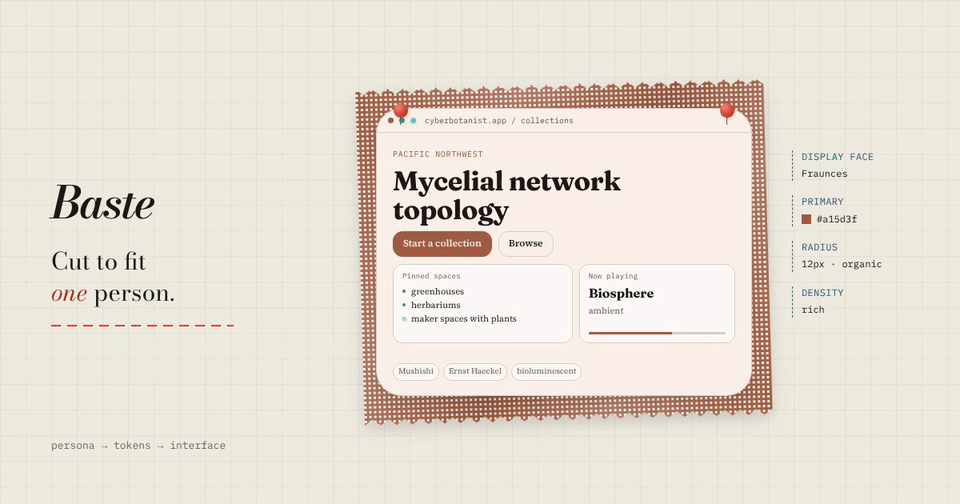

# Baste

**Interfaces cut to fit one person.**



**[Watch the 74-second tour](site/public/media/tour/baste-tour.mp4)**: measure a person, re-cut one screen for
three people, judge two dozen drafts, keep the files. It plays on the site's home page and in the Studio guide
(`/docs/`), with English and French captions.

*Baste (v.) — to tack a garment together with long, loose stitches so it can be fitted before the final cut.*

Baste takes a persona's films, music, rooms, tools and obsessions, and from them drafts the design system, icons,
images and motion that fit. Palettes and typefaces are derived from the persona's cultural references, so no two
personas come out the same. Then it explores many candidates with quality-diversity search, judges them for
persona fit, and cuts the winners into production assets.

Now with **semantic version control for design systems** and **OpenPencil bridge** for editable design components.

## The Studio

```bash
npx baste gui        # local API on :3456 — then open the site's /gui route
```

The Studio (`site/`, route `/gui`) puts one persona at the centre: see it **wearing its own design** (a live
try-on of the same screen in its tokens, with contrast checks), export tokens, draft prompts and generate assets
with a staged progress view, pin a moodboard, read a decomposed brand kit, teach it your taste, and edit tokens
as an OpenPencil document. Without a local server it runs in demo mode on the built-in personas.

Start the API and Qwik Studio together from the repository root:

```bash
devenv tasks run baste:install
devenv up
```

Open `http://localhost:5173/gui/` for the Studio and `http://localhost:5173/docs/` for documentation.
The site proxies `/api` to the Baste API on port 3456. Storybook is opt-in.
See [local development](docs/development.md) for tasks, port overrides and verification boundaries.

## Not Organic accounts

Studio Settings includes profile creation/sign-in through Not Organic, the authorized model catalog,
wallet credit and advertised checkout offers. Hosted image generation and Jev judging use server-held
PKCE/DPoP authorization. Design personas are separate from the public account profile, and account-owned
design files are isolated by DID. Local CLI generation continues to use your selected provider keys.

Enable `NOTORGANIC_ENABLED=true` with an exact `BASTE_PUBLIC_ORIGIN` after registering Baste's product
and origin on the provider. Payments require provider-configured offers and an HTTPS return origin.
Source integration does not establish that a deployed sign-in or paid checkout works.
See [Not Organic integration](docs/notorganic.md) for the configuration and API contract.

## Quick Start

```bash
# Install globally
npm install -g baste

# Or run directly with npx
npx baste list
```

## Commands

### Browse Personas

```bash
baste list              # List all personas (base + custom)
baste show cyberbotanist # Show persona details
```

### Create Custom Personas

```bash
# Extend from a built-in base persona
baste create mybotanist --base cyberbotanist --name "My Botanist"

# Create from a JSON file
baste create mypersona --from ./persona.json

# Delete a custom persona
baste delete mybotanist
```

Custom personas are saved to `./personas/` as JSON files and take priority over built-in personas.

### Generate Assets

```bash
# Generate asset suite for a persona
baste generate cyberbotanist

# Generate full UI kit
baste ui-kit nightmarketcoder --output-dir ./my-app/assets

# Dry run (see prompts without calling APIs)
baste generate cyberbotanist --dry-run

# One fal key for everything: Seedream images, Recraft SVG, Seedance video, a vision judge
baste generate cyberbotanist --provider fal

# Or choose per stage
baste generate cyberbotanist --image-provider fal --svg-provider quiver --judge openai

# Export design tokens
baste tokens liminalweeb --format css   # css, tailwind, json
```

### Design Version Control

**Semantic version control** for design components and cultural experiences. Track every token change, cultural reference, and design decision as semantic changes (not just file diffs).

```bash
# Initialize version control for a persona
baste init cyberbotanist

# Show full history (commits, changes, cultural refs)
baste history cyberbotanist --limit 20

# Update a design token (creates a semantic change record)
baste update cyberbotanist colors.primary "#FF6B35"
baste update cyberbotanist typography.fontFamily.heading "'Space Grotesk', sans-serif"

# Create a design branch for exploration
baste branch cyberbotanist "neon-alternate"
baste switch cyberbotanist "neon-alternate"

# Diff two versions
baste diff <version-id-1> <version-id-2>

# Revert to previous version (creates new revert commit)
# (use the registry API programmatically)
```

### Decompose a Live Site

Pull a real URL into a Baste persona + brand kit (palette with role assignment, fonts, `@font-face` URLs, logo, OG image, image inventory, plus inferred aesthetic signals).

```bash
# Basic: fetch HTML + linked CSS, extract palette/fonts/logo
baste decompose https://qwik.dev --id qwik

# Deep: full JS rendering via Playwright (required for SPA sites)
baste decompose https://example.com --deep

# Mirror logo/OG/images to disk; auto-initialize design versioning
baste decompose https://stripe.com --mirror-assets --init

# Custom slug + display name
baste decompose https://acme.example --id acme --name "Acme Co."
```

Outputs:
- `./personas/<id>.json` — the draft persona (aesthetic inferred from extracted signals)
- `./personas/<id>.brandkit.json` — literal extracted artifacts (palette roles, font-faces, image URLs, signals)
- `./assets/decomposed/<id>/` — mirrored logo/OG/thumbnails (with `--mirror-assets`)

The extracted palette and fonts flow into `baste tokens <id>` automatically — `--color-primary` will be the real brand color.

**Deep mode** requires Playwright. Install once:
```bash
npm install --save-dev playwright && npx playwright install chromium
```

### Remix Personas

Cross two personas (and their brand kits) into a new one:

```bash
baste remix cyberbotanist nightmarketcoder --as solar-night
```

### Cultural Experiences

Link images, screenshots, logos, and references to personas to capture the cultural DNA behind design decisions.

```bash
# Show cultural references for a persona
baste culture cyberbotanist

# Add cultural references from images
baste culture cyberbotanist ~/Pictures/cultural/hero-ref.png ~/Pictures/cultural/palette-inspiration.jpg

# Scan an entire directory
baste culture nightmarketcoder ~/Pictures/memes/
```

Cultural references are embedded in the design system history and exported with `.baste` files, so the "why" behind every design decision travels with the design.

### Export / Share / Import

**The `.baste` format**: portable, self-contained design system packages.

```bash
# Export persona's complete design system (persona, tokens, history, refs)
baste export cyberbotanist ./cyber-design.baste

# Import a design system (creates new branch if persona exists)
baste import ./some-design.baste

# Export to OpenPencil for visual editing
baste openpencil cyberbotanist ./cyber-editable.pen
```

`.baste` files contain:
- Full persona definition
- All design tokens (with history)
- Cultural references (with rationale)
- Version graph (branches, commits, semantic changes)
- Embedded assets (small files as data URLs)
- Compatibility metadata

### Configuration

```bash
# Create default config file
baste config --init

# Get/set config values
baste config --get qd.iterations
baste config --set qd.iterations 10

# Use custom config file
baste generate cyberbotanist --config ./my-config.json
```

Config is loaded from `baste.config.json` or `.bastec.json` in the current directory.

### Web GUI

```bash
# Start the web interface
baste gui --port 8080
```

Browse to `http://localhost:8080` to create, edit, and manage personas through a visual interface.

## Configuration File

`baste.config.json`:

```json
{
  "outputDir": "./assets/output",
  "personaDir": "./personas",
  "evaluator": {
    "model": "gpt-4o"
  },
  "qd": {
    "iterations": 5,
    "batchSize": 3,
    "mutationRate": 0.4,
    "qualityThreshold": 0.5
  },
  "outputCount": 3,
  "generators": {
    "image": { "provider": "openai", "model": "gpt-image-2" },
    "svg": { "provider": "quiver" },
    "video": { "provider": "veo" }
  }
}
```

## Programmatic API

### Persona Management

```typescript
import { getPersona, savePersona, buildPersona, extendPersona } from "baste";
import { generateUIKit } from "baste";

// Get a persona
const persona = getPersona("cyberbotanist");

// Create custom persona
const draft = buildPersona({
  id: "mypersona",
  name: "My Persona",
  summary: "A brief description",
  culture: { subcultures: ["solarpunk"], values: ["growth"] },
  influences: { films: ["Annihilation"], music: { genres: ["ambient"], artists: [] } },
  behaviors: { interfaceValues: ["discoverability"], discovery: [], platforms: [], expression: [], petPeeves: [] },
  aesthetic: { colorTemperature: "warm", density: "rich", visualKeywords: ["organic"], moodKeywords: ["growth"] },
});
savePersona(draft);

// Extend from a base
const variant = extendPersona(persona!, { id: "variant", name: "Variant" });
savePersona(variant);

// Generate UI kit
const kit = await generateUIKit(persona!, config);
```

### Design Version Control

```typescript
import {
  DesignVersionRegistry,
  exportDesignSystem,
  importDesignSystem,
  exportToOpenPencil,
} from "baste";

const registry = new DesignVersionRegistry({ author: "designer@team" });

// Initialize version control for a persona
const { branch, version, component } = registry.initPersona(persona);

// Update tokens (semantic change tracking)
const { changes } = registry.updateComponentTokens(component.id, (tokens) => ({
  ...tokens,
  colors: { ...tokens.colors, primary: "#4A7C59" },
}));

// Add cultural references from images
const refs = registry.scanCulturalImages(
  persona.id,
  ["~/Pictures/kill-la-kill-reference.jpg", "~/Pictures/veritas-logo.png"],
  "Core aesthetic references"
);

// Create design branch for exploration
registry.createBranch(persona.id, "neon-exploration");
registry.switchBranch(persona.id, "neon-exploration");

// Export for sharing
registry.exportToFile(persona.id, "./my-design.baste");

// Export to OpenPencil for visual editing
await registry.exportToOpenPencilFile(persona, "./editable.pen");

// Import from a shared `.baste`
const imported = registry.importFromFile("./shared-design.baste");

// Show history
console.log(registry.getHistoryLog(persona.id));

// Diff between versions
const diff = registry.diff("version-a", "version-b");
```

### Semantic Change Types

Every design change is tracked with semantic meaning:

| Change Type | What it means |
|------------|---------------|
| `color_change` | Token color changed (e.g., primary: `#8B6914` → `#4A7C59`) |
| `typography_change` | Font or type scale changed |
| `spacing_change` | Spacing or density changed |
| `border_change` | Border radius/style changed |
| `shadow_change` | Shadow or glow changed |
| `motion_change` | Timing/easing changed |
| `cultural_ref_added` | New cultural reference added to persona |
| `cultural_ref_removed` | Cultural reference removed |
| `persona_updated` | Persona definition changed |
| `merge` | Design system merge occurred |
| `custom` | User-defined change |

### OpenPencil Bridge

Convert Baste personas to editable OpenPencil documents:

```typescript
import { personaToOpenPencil, serializeOpenPencil, extractTokensFromOpenPencil } from "baste";

// Export to editable format
const doc = personaToOpenPencil(persona, tokens, culturalRefs);
const json = serializeOpenPencil(doc);

// Edit in OpenPencil, then import back
const modifiedTokens = extractTokensFromOpenPencil(doc);
```

The OpenPencil document contains:
- **Design Tokens page**: All tokens as visual swatches (colors, fonts, spacing, borders, motion)
- **Cultural Board**: Mood keywords and visual references organized as frames
- **Component Library**: Button primary, Card, Hero Section ready to use
- **Cultural Context**: Embedded rationale for why each choice was made

## Built-in Personas

| Persona | Description | Aesthetic |
|---------|-------------|-----------|
| `cyberbotanist` | Mycelial networks, bioluminescence, solarpunk | Warm, organic, textured |
| `nightmarketcoder` | Neon night markets, city pop, chaotic density | Warm, maximalist, snappy |
| `liminalweeb` | Abandoned malls, vaporwave, digital decay | Cool, minimal, grainy |

## `.baste` File Format

The `.baste` format is a shared, version-controlled design system that can be passed between people and tools:

```json
{
  "version": "0.2.0",
  "schema": "baste-design-v1",
  "persona": { ...full persona definition... },
  "components": [ ...design components with tokens... ],
  "versions": [ ...commit history... ],
  "changes": [ ...semantic changes... ],
  "culturalRefs": [ ...references with rationale... ],
  "metadata": {
    "name": "Cyberbotanist Theme",
    "exportFormat": "baste",
    "compatibility": ["open-pencil", "baste-cli", "lix-v1"]
  }
}
```

- **Portable**: Single JSON file
- **Self-contained**: Embeds assets as data URLs
- **Versioned**: Full history graph included
- **Culturally annotated**: References explain *why* each choice was made
- **Tool-agnostic**: Works with OpenPencil, any CLI, Lix-aware systems

## Environment Variables

```bash
OPENAI_API_KEY=sk-...      # GPT Image 2.5 + fallback OpenAI judge
QUIVER_API_KEY=qv-...      # SVG generation
ARK_API_KEY=...           # Seedance video generation (default)
TYPESAFE_API_KEY=...      # TypeSafe System One (Jev) judge, auto-selected when set
GOOGLE_API_KEY=AIza...     # Gemini images / Veo video (optional)
FAL_KEY=...                # fal: --provider fal for every stage, and companion voice
```

## The tour video

The tour is a [HyperFrames](https://hyperframes.heygen.com/) composition in `videos/baste-tour/`, cut from
screens recorded on this site. `scripts/record-tour.mjs` records them, `scripts/narrate-tour.mjs` and
`scripts/score-tour.mjs` make the narration and music on fal, `build.mjs` composes it, and `publish.mjs` puts the
video, captions and the Studio guide's chapter clips into `site/public/media/tour/`. See
[local development](docs/development.md#tour-video) for the commands.

## Architecture

```
Baste
├── Persona Engine          # Cultural identity, influences, aesthetic
├── Design System           # CSS/Tailwind/Panda tokens from persona
├── QD Engine               # Quality Diversity search for diverse assets
├── LLM Judge               # Evaluates persona alignment
├── Version Control (NEW)   # Lix-inspired semantic versioning
│   ├── SQLite database     # Change-first, not snapshot-first
│   ├── Branches            # Parallel design exploration
│   ├── Cultural refs       # Images, screenshots, logos linked to history
│   └── .baste exporter     # Portable design system packages
└── OpenPencil Bridge (NEW) # Editable .pen documents round-trip
```

## License

MIT
