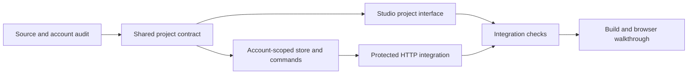

# Design partner implementation

Started October 1, 2026. This tracks execution of [the design partner plan](design-partner.md). Existing site/account work and unrelated design changes remain protected.

## First working milestone

Saved application projects with a brief, an account-owned audience snapshot, revision history and restore. The project opens the existing audience fitting tools. Generated partners, conversation, automatic refinement, Live and motion follow the project foundation; this milestone does not simulate those capabilities.

| Wave | Owner and output | Gate |
| --- | --- | --- |
| 1 | Coordinator: shared types; explorer: current account integration | Existing routes and gaps identified; no provider spending |
| 2 | Store worker: durable commands; Studio worker: project surface | Disjoint files; shared types remain coordinator-owned |
| 3 | Coordinator: protected HTTP routes and integration checks | Isolation, stale revisions, idempotent retry, restore and reload |
| 4 | Coordinator: static checks, build and browser walkthrough | Create, edit, restore and reopen a project at desktop/mobile widths |

Store ownership: `src/projects/store.ts`, `src/projects/commands.ts`, supporting files under `src/projects/` except `contracts.ts`, and `tests/projects.test.ts`. Use existing account scope; preserve exact command results for retries. Errors and failed writes must not silently reset stored projects.

Studio ownership: `site/src/components/studio/flows/projects.tsx`, `site/src/lib/projects.ts`, `site/src/components/studio/context.ts`, `site/src/components/studio/rail.tsx`, and `site/src/routes/gui/index.tsx`. Reuse the existing atelier controls. Signed-out hosted users must not see local project records, and demo mode must not claim server persistence.

Coordinator ownership: `src/projects/contracts.ts`, `src/gui/api.ts`, public exports if needed, this execution record and integration tests. Route all project commands through existing origin, CSRF and account checks. Preserve dirty files and tracked generated artifacts unrelated to this milestone.

Verification order: focused store and HTTP tests; root typecheck/build; site typecheck/lint/build; real local browser create/edit/restore/reload walkthrough. Separately report live OAuth, paid inference, payment and deployment evidence. No commit, publication or paid provider call is required for this milestone.

## Status

- Source audit: site has Not Organic account, catalog, wallet, checkout and hosted image/Jev routes. Live remains unwired in Baste.
- Shared project transport contract: defined.
- Account-scoped store and HTTP commands: implemented, including atomic revisions, durable retry receipts, stale-write rejection and explicit interrupted-lock repair.
- Studio Projects view: implemented with brief/audience editing, history restore and conflict handling that retains drafts.
- Verification: root typecheck/build and all 116 root tests pass; five site account tests pass; site typecheck, lint, client build, SSR and static generation pass. Existing generated server/typecheck files were restored byte-for-byte after verification to preserve prior work.
- Running preview: Devenv supervises the API and site at `http://localhost:5173`. Local HTTP create/edit/restore/reload and persistence after an API restart passed, leaving a project named Baste design partners with the agreed brief at `/gui/?flow=projects&project=6585ae6d-3aee-8596-a572-72ccdef15b52`.
- Browser follow-up: the user's open preview exposed a cached Vite SSR missing-import error after the new component was added. Restarting the site cleared it. The real Projects screen now displays the saved brief, audience selector and history without browser errors; editing and discarding a draft were verified at the current narrow viewport. A complete desktop/mobile save/restore walkthrough remains to be done.
- Hosted verification: Not Organic is disabled in this local checkout. Live signup/token exchange, paid inference, checkout settlement and deployment remain unverified.
